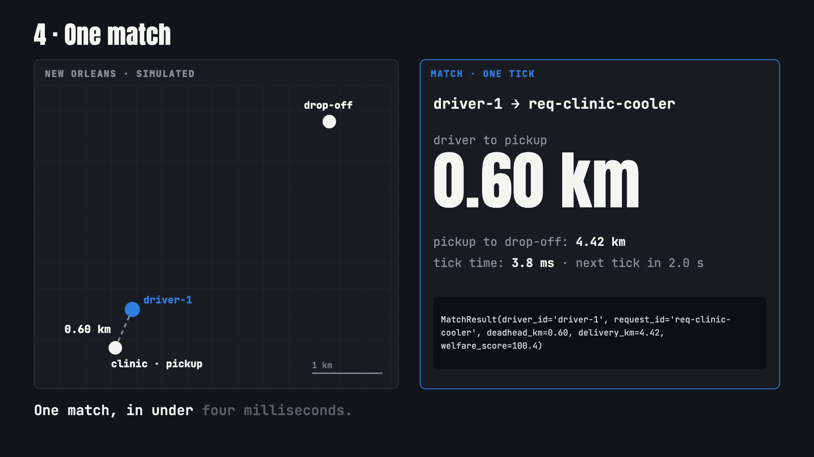

# OpenHaul (PeerPath Logistics)

**OpenHaul is the matching and custody engine for a planned delivery network where independent drivers carry parcels in their own vehicles.** There is no shipper or driver app yet: today it runs as code and in simulation.

[](https://nojuannobody.github.io/openhaul/explainer/explainer.mp4)

[▶ Watch the 73-second explainer](https://nojuannobody.github.io/openhaul/explainer/explainer.mp4) · [Read the one-page explainer](https://nojuannobody.github.io/openhaul/explainer/)

### How it works for you (as modelled in the code)
1. **A shipper posts a delivery request**: pickup, drop-off, weight, volume, priority, payout and, for cold chain, a temperature band.
2. **Every 2 seconds the dispatch loop** keeps drivers who are online and have room, and the Rust engine scores each driver–request pair (payout × priority weight, minus the empty drive to pickup).
3. **The driver gets the job but sees one checkpoint at a time**; the real drop-off address appears only within 0.8 km of it.
4. **At pickup, a scan moves the parcel into custody** with a Groth16 proof that its temperature readings stayed in band (development trusted setup; the RFID signature check is still simulated).
5. **On drop-off the record completes**, or flips to `DISPUTED_EXCURSION` if the cold chain broke while in custody.

Status: the engine, loop, hidden drop-off and custody record work in simulation and are tested. An app, pilots with real drivers, signed RFID scans and the legal/insurance setup do not exist yet (see [`docs/blueprint/`](docs/blueprint/README.md)).

OpenHaul is a decentralized, high-resilience spatio-temporal logistics protocol and matching engine engineered for peer-to-peer parcel and freight delivery, featuring Zero-Knowledge chain-of-custody verification, anti-hijacking waypoint obfuscation, and FEMA disaster triage prioritization.

---

## Architecture & Monorepo Layout

```
openhaul/
├── Cargo.toml                          # Rust virtual workspace
├── crates/
│   ├── stmp-core/                      # Spatio-Temporal Matching Protocol (H3, 1099 matrix, Bipartite Graph)
│   │   ├── Cargo.toml
│   │   ├── src/lib.rs
│   │   └── src/bin/stmp_match.rs       # JSON-in/JSON-out matching CLI used by Python
│   └── zk-custody/                     # Zero-Knowledge chain-of-custody, RFID verification, HNOA state machine
│       ├── Cargo.toml
│       ├── src/lib.rs
│       └── src/zk.rs                   # Groth16 temperature-band proof
├── python/
│   ├── graph_loop/                     # Sub-2000ms periodic dispatch matching loop
│   │   ├── __init__.py
│   │   ├── matcher.py                  # Bipartite welfare maximization solver
│   │   ├── obfuscator.py               # Dynamic progressive waypoint obfuscation engine
│   │   └── loop.py                     # 2.0s periodic tick loop
│   ├── chaos_sim/                      # Chaos engineering & disaster resilience framework
│   │   ├── __init__.py
│   │   ├── generator.py                # Synthetic telemetry generator (Normal Metro vs FEMA Disaster)
│   │   └── runner.py                   # Invariant checker (40% fleet dropouts, RFID replay attacks)
│   └── tests/
│       ├── test_graph_loop.py
│       └── test_chaos_sim.py
├── pyproject.toml
└── README.md
```

---

## 1. Rust Crates

### `stmp-core` (Spatio-Temporal Matching Protocol)
- **H3 Spatial Indexing**: Spatial cell coordinate hashing and grid distance computations.
- **1099 Capacity Matrix**: Models independent driver fleet constraints (500–1000 lbs, 15–60 cu ft, cold-chain refrigeration capability, and planned trajectory tracking).
- **Bipartite Social Welfare Graph**: Scores candidate matching edges factoring in deadhead km, transit distance, and priority tiers (`Standard`, `Expedited`, `MedicalCritical`, `DisasterTriageFema`).

### `zk-custody` (Zero-Knowledge Chain-of-Custody)
- **HNOA State Machine**: Hired and Non-Owned Auto insurance transitions (`IDLE` -> `EN_ROUTE` -> `IN_CUSTODY_RFID_VERIFIED` -> `COMPLETED`, or `DISPUTED_EXCURSION`).
- **RFID Scan Commitment**: SHA-256 hash commitment binding driver identity, package RFID tag, reader public key, and H3 location. RFID signature verification is simulated (string-based check), not cryptographic.
- **Cold-Chain Invariant Monitoring**: Ingestion and verification of temperature telemetry thresholds (e.g. 2.0°C – 8.0°C).
- **Temperature-band proof (Groth16, BN254; `src/zk.rs`)**: `CustodyZkProof::generate_proof` proves that 8 private temperature readings all lie inside a public band and open a public Poseidon commitment. It uses a development trusted setup (whoever runs `setup` could forge proofs); production needs a multi-party ceremony. Privacy of driver GPS routes or PII is not covered by this proof.

---

## 2. Python Dispatch & Chaos Framework

### `graph_loop`
- **`matcher.py`**: Thin client for the Rust matcher. It serializes drivers and requests to JSON, runs the `stmp_match` binary (`cargo build --bin stmp_match`), and maps the matches back; the scoring rules (including the 6.0x FEMA-tier weight) live only in `stmp-core`.
- **`obfuscator.py`**: Anti-hijacking waypoint obfuscation that withholds the final destination from the driver until entering the terminal H3 k-ring threshold (< 800m).
- **`loop.py`**: Periodic 2.0s tick loop managing active dispatches with sub-2000ms SLA.

### `chaos_sim`
- **`generator.py`**: Telemetry generator synthesizing normal metro days and severe disaster surges (e.g. Hurricane Katrina).
- **`runner.py`**: Injects 40% fleet dropouts, RFID replay attacks, and cold-chain breaches; asserts zero over-allocation, zero double-dispatch, and SLA compliance.

---

## Verification & Testing

### Running Rust Workspace Tests
```bash
cargo test --workspace
```
*Result: 12 unit tests passed across `stmp-core` and `zk-custody` (as of commit 3090be0).*

### Running Python Test Suite
```bash
python3 -m unittest discover -s python/tests
```
*Result: 14 unit/integration tests passed (requires the `stmp_match` binary built first).*

### Benchmark Performance
*Benchmark numbers come from synthetic simulation (`chaos_sim`), not real telemetry.*
- **Matching Loop Latency**: ~4–10ms per tick (far below the 2,000ms threshold).
- **Normal Metro Match Rate**: 100% on-time matching.
- **Disaster Surge (40% Fleet Dropouts)**: 100% capacity invariant compliance, zero double dispatch, 100% malicious RFID replay rejection, and prioritizing FEMA critical cargo.
